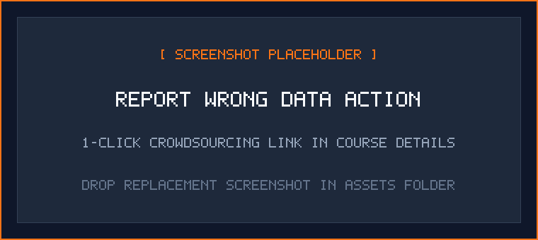
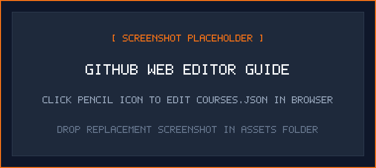

# Contributing to UIU Course Code Decoder

Thank you for your interest in contributing to **UIU Course Code Decoder**! This project is maintained by and for students of United International University (UIU). Keeping the university course catalog accurate, complete, and up to date relies on community contributions.

Whether you want to fix an outdated course title, submit exam routine updates, or contribute an entire department's curriculum, your help is welcome.

---

## Two Ways to Contribute

### 1. Fast: Report an Issue via the Extension
If you notice incorrect course information while using the extension, you do not need Git or GitHub experience:
1. Open the extension popup in your browser.
2. Select **Course catalog** and click on the course in question.
3. Scroll down in the Course Details view and click **Report incorrect details**.
4. A pre-filled GitHub issue will open with the course's exact details. Review the details, describe the correction, and submit on GitHub. A GitHub account is required.
5. To request a missing course, open **Improve catalog → Request a missing course**. Adding or editing a course locally does not submit it to GitHub.

Include an official source and the trimester/year for exam routine changes. Remove student IDs and personal information from screenshots.

<p align="center">
  
</p>
<p align="center"><em>Clicking 'Report incorrect details' opens an GitHub draft pre-filled with the course metadata.</em></p>

---

### 2. Direct: Submit Changes to `courses.json`
If you want to add new courses or edit existing ones directly, you can submit a Pull Request modifying `courses.json`.

The catalog currently covers **CSE, EEE, BBA, and Data Science** programs. Contributions for other departments (Civil, Pharmacy, English, Economics, etc.) or newly introduced electives are especially helpful.

---

## Course Data Specification (`courses.json`)

The `courses.json` file is a JSON object where each key is an uppercase course code mapped to an object containing course details.

### Schema Fields

| Field | Type | Required? | Rules & Guidelines |
|---|---|:---:|---|
| `name` | `string` | **Yes** | Official course name, properly capitalized (e.g., `"Database Management Systems"`). |
| `credits` | `number` | No | Academic credit hours (e.g., `3`, `1.5`, `1`, `2`, `4`). Displayed as not listed if omitted. |
| `examDay` | `string` | No | Exam routine day: strictly `"Day 1"` through `"Day 7"` (or `"In-Class"` for lab/viva), or `""` if not scheduled. |
| `examSlot` | `string` | No | Exam routine slot: strictly `"T1"` (09:00 AM – 11:00 AM), `"T2"` (11:30 AM – 01:30 PM), or `"T3"` (02:00 PM – 03:00 PM), or `""` if not scheduled. |
| `prerequisites` | `Array<string>` | No | **Course codes only** (e.g., `["CSE 2213"]`). Use an empty array `[]` when prerequisites are unknown. Use `["None"]` only when no prerequisites have been confirmed. **Never include credit counts or text notes here.** |
| `prerequisiteNote` | `string` | No | Non-course prerequisites or degree credit thresholds (e.g., `"MINIMUM 85 credits"`). Omit or set to `""` if none. |

### Formatting Rules

1. **Course Code Format**: Use uppercase letters, exactly one space, then numbers (e.g., `"CSE 3421"`, not `"CSE3421"` or `"cse 3421"`).
2. **Alphabetical Sorting**: Keep entries in `courses.json` sorted alphabetically by course code.
3. **Prerequisites vs. Prerequisite Notes**:
   - Put prerequisite course codes strictly in `prerequisites` (e.g., `["CSE 1111", "CSE 1112"]`).
   - Put degree milestones and credit requirements in `prerequisiteNote` (e.g., `"MINIMUM 85 credits"`).

### Schema Examples

#### Standard Lecture Course with Prerequisites:
```json
"CSE 3421": {
  "name": "Database Management Systems",
  "credits": 3,
  "examDay": "Day 2",
  "examSlot": "T1",
  "prerequisites": ["CSE 2213"]
}
```

#### Lab / Practical Course (In-Class Evaluation):
```json
"CSE 3422": {
  "name": "Database Management Systems Laboratory",
  "credits": 1,
  "examDay": "In-Class",
  "examSlot": "",
  "prerequisites": ["CSE 2213"]
}
```

#### Senior Capstone / Project with Credit Requirements:
```json
"CSE 4000A": {
  "name": "Final Year Design Project - I",
  "credits": 3,
  "examDay": "Day 4",
  "examSlot": "T2",
  "prerequisites": [],
  "prerequisiteNote": "MINIMUM 85 credits"
}
```

#### Introductory Course without Prerequisites:
```json
"EEE 1011": {
  "name": "Electrical Circuits I",
  "credits": 3,
  "examDay": "Day 1",
  "examSlot": "T1",
  "prerequisites": []
}
```

---

## Submitting Your Changes

### Option 1: Editing Directly on GitHub (Recommended for Quick Edits)
You can submit edits directly through GitHub without setting up local development tools:

1. Open [`courses.json`](https://github.com/litch07/uiu-course-decoder/blob/main/courses.json) on GitHub.
2. Click the **pencil icon** (Edit this file) in the upper-right corner. GitHub will automatically create a fork and branch for you.
3. Make your edits following the schema rules above.
4. Under **Commit changes**, write a brief description of what you changed (for example, `Add Pharmacy first-year courses`), then select **Propose changes**.
5. Select **Create pull request** to submit your changes for maintainer review.

<p align="center">
  
</p>
<p align="center"><em>Click the pencil icon on GitHub to edit courses.json and propose changes directly in your browser.</em></p>

---

### Option 2: Working Locally with Git (Recommended for Large Batches)
For larger contributions, such as an entire degree curriculum:

1. **Fork and Clone the Repository**:
   ```bash
   git clone https://github.com/YOUR_USERNAME/uiu-course-decoder.git
   cd uiu-course-decoder
   ```
2. **Create a Feature Branch**:
   ```bash
   git checkout -b add-pharmacy-courses
   ```
3. **Edit `courses.json`**: Add your courses in alphabetical order.
4. **Run the Local Verification Suite**:
   ```bash
   node tests/run_all.js
   ```
5. **Commit and Push**:
   ```bash
   git add courses.json
   git commit -m "Add Pharmacy undergraduate course catalog"
   git push origin add-pharmacy-courses
   ```
6. **Open a Pull Request**: Visit the original repository on GitHub and click **Compare & pull request**.

---

## Automated CI Verification

Every Pull Request triggers an automated GitHub Actions check ([`.github/workflows/validate-catalog.yml`](.github/workflows/validate-catalog.yml)) that verifies:
- ✅ **JSON Syntax**: Confirms `courses.json` is well-formed JSON.
- ✅ **Schema Compliance**: Confirms all entries have valid titles and expected data types.
- ✅ **Purity of Prerequisites**: Confirms credit requirements are placed in `prerequisiteNote`, not inside `prerequisites`.
- ✅ **Alphabetical Ordering**: Confirms course keys are sorted alphabetically.
- ✅ **Test Suite**: Runs the full automated regression suite.

If a check fails, review the GitHub Actions workflow log for details.

---

## Glossary for Beginners

- **Repository**: The project workspace on GitHub containing all code, data files, and documentation.
- **Fork**: A personal copy of the repository on your own GitHub account.
- **Branch**: An isolated workspace within your fork for a specific set of changes.
- **Commit**: A saved revision with an explanatory message.
- **Pull Request (PR)**: A proposal asking maintainers to merge your changes into the main project.

Missing properties in a local override inherit catalog values. Explicit empty strings, empty prerequisite arrays, and `credits: null` clear those fields. Legacy string records change only the name; new exports and imports use objects. Exam day aliases are normalized before schedule comparisons. Unknown credits and unverified exam dates must never be guessed.
