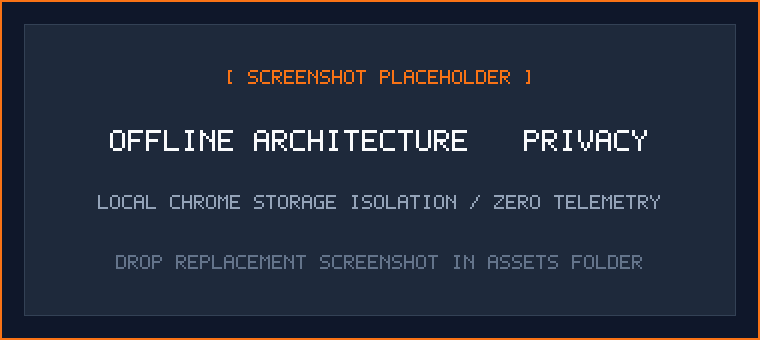

# Privacy Policy — UIU Course Code Decoder

**Effective Date:** November 2026
**Extension Version:** 2.0.0+
**Publisher & Maintainer:** Sadid Ahmed ([@litch07](https://github.com/litch07))
**Repository:** [https://github.com/litch07/uiu-course-decoder](https://github.com/litch07/uiu-course-decoder)

---

## Core Privacy Philosophy

**UIU Course Code Decoder** is an offline-first browser extension engineered for students and faculty of United International University (UIU). It matches course codes on university webpages and displays course titles, exam routines, and prerequisite chains.

The extension is designed around one strict principle: **Zero Data Collection**. It collects no personal data, transmits no analytics, sets no tracking cookies, and executes entirely within your local browser.

<p align="center">
  
</p>
<p align="center"><em>Security and privacy boundary: Local browser storage isolation with no telemetry; catalog updates run only when requested.</em></p>

---

## Data Collection & Telemetry

| Category | Status | Technical Details |
|---|:---:|---|
| **Telemetry & Analytics** | ❌ None | No analytics SDKs (e.g., Google Analytics, Mixpanel, Sentry) are included or loaded. |
| **User Identifiers / UUIDs** | ❌ None | No unique installation IDs, browser fingerprints, or machine hashes are generated. |
| **Browsing History** | ❌ None | Webpage URLs, navigation histories, and tab lists are never logged, recorded, or stored. |
| **Page Content** | ❌ None | Only text nodes matching verified UIU course code patterns are parsed to render course cards. |
| **Form Data & Passwords** | ❌ None | Input fields, textareas, password inputs, and editable regions are unconditionally ignored. |
| **Crash Reporting** | ❌ None | Error events stay strictly inside your local browser Developer Tools console. |

---

## Local Storage Architecture

All extension preferences, allowed domains, and custom course entries reside exclusively in **`chrome.storage.local`** on your device. No data is synchronized to external servers or cloud accounts:

| Storage Key | Type | Description & Purpose |
|---|---|---|
| `courses` | `Object` | The active merged course catalog, combining bundled defaults, user edits, and updates from manual syncs. |
| `userCourses` | `Object` | User-added courses or local custom overrides made to official courses. |
| `softDeletedCourses` | `Object` | Courses moved to Trash, restorable at any time with edits intact. |
| `hardDeletedCourses` | `Object` | Course codes permanently removed from the catalog. Prevents manual syncs from re-adding them. |
| `allowedSites` | `Array<string>` | Domain hostnames where the user has explicitly authorized the extension to execute. |
| `remoteCourses` | `Object` | Cached catalog downloaded during the most recent user-initiated manual sync. |
| `mode` | `string` | Active visual presentation style: `"highlight"`, `"tooltip"`, or `"inline"`. |
| `showExamInfo` | `boolean` | Display preference for exam routine days and slots. |
| `showPrerequisites` | `boolean` | Display preference for prerequisite course codes and credit requirements. |
| `lastSyncedAt` | `number` | Unix timestamp of the most recent successful catalog synchronization. |
| `lastSyncResult` | `Object` | Summary diff of the last sync (`added`, `updated`, `removed` counts and codes). |

---

## Network Communication

The extension performs **zero periodic background network requests**. There is only **one optional, user-initiated outbound request**:

- **"Update course catalog"** button (located in the Settings panel):
  Downloads the latest shared course catalog directly from GitHub:
  ```
  https://raw.githubusercontent.com/litch07/uiu-course-decoder/main/courses.json
  ```
  - **No cookies, authentication tokens, or personal identifiers** are transmitted with this request.
  - The response payload is subject to schema verification and an enforced **2 MB payload size cap** before processing.
  - This network request occurs **only** when the user manually clicks the sync button.

---

## Host Permissions & Site Security

In strict compliance with the Chrome Web Store Principle of Least Privilege, the extension operates under an **optional host permissions** model:

- Broad web access is disabled; `<all_urls>` is omitted from `manifest.json`.
- The extension runs exclusively on domains you explicitly activate via the **Active on this page** toggle or manage in the **Settings** domain list.
- When an authorized domain is enabled, the extension dynamically registers content scripts (`chrome.scripting.registerContentScripts`) specifically for that origin. This ensures course codes decode reliably across page refreshes without requiring blanket background privileges.
- You can revoke permission for any domain at any time through the extension's Settings panel or via `chrome://extensions`.

---

## Content Script Behavior & Security Hardening

The content script (`content.js`):
1. **Zero-`innerHTML` Policy**: All overlays, tooltips, and inline labels are constructed using safe DOM methods (`document.createElement`, `document.createTextNode`, `node.textContent`). The codebase contains zero occurrences of `innerHTML` or `insertAdjacentHTML`, eliminating DOM-based Cross-Site Scripting (XSS) risks.
2. **Ignored Elements**: Text matching automatically skips `<input>`, `<textarea>`, `<select>`, and `[contenteditable]` elements, as well as `<script>`, `<style>`, `<iframe>`, and PDF documents.
3. **Duplication Guard**: An internal marker (`window.__UIU_COURSE_DECODER_INJECTED__`) prevents redundant script initialization.

---

## Data Retention & Erasure

Because all data lives strictly on your personal device:
- **Reset to Default**: You can reset your course catalog to factory defaults at any time inside Settings using the **Reset to Default** action.
- **Manual Clearing**: You can purge all extension storage at any time via `chrome://extensions` &rarr; **UIU Course Code Decoder** &rarr; **Details** &rarr; **Clear storage data**.
- **Complete Removal**: Uninstalling the extension permanently deletes all stored preferences, allowed domains, and catalog entries from your disk.

---

## Contact & Vulnerability Reporting

If you have questions regarding this privacy policy or wish to report a security inquiry:
- **GitHub Repository**: [https://github.com/litch07/uiu-course-decoder](https://github.com/litch07/uiu-course-decoder)
- **Private Security Advisories**: [https://github.com/litch07/uiu-course-decoder/security/advisories/new](https://github.com/litch07/uiu-course-decoder/security/advisories/new)
- **Security Policy**: See [`SECURITY.md`](SECURITY.md) for disclosure handling timelines and scope.
