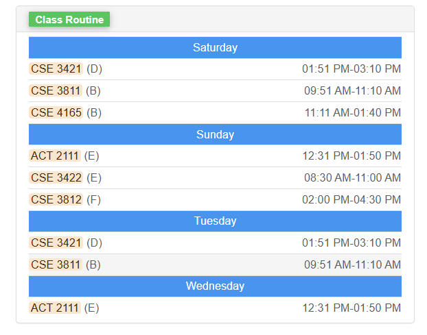
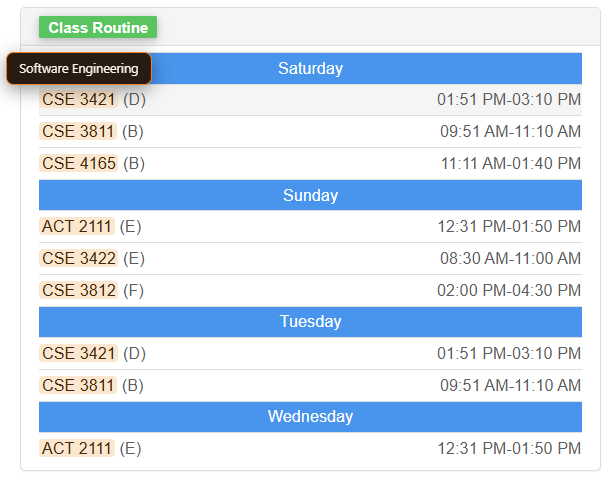
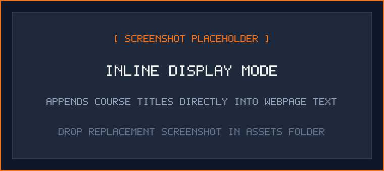
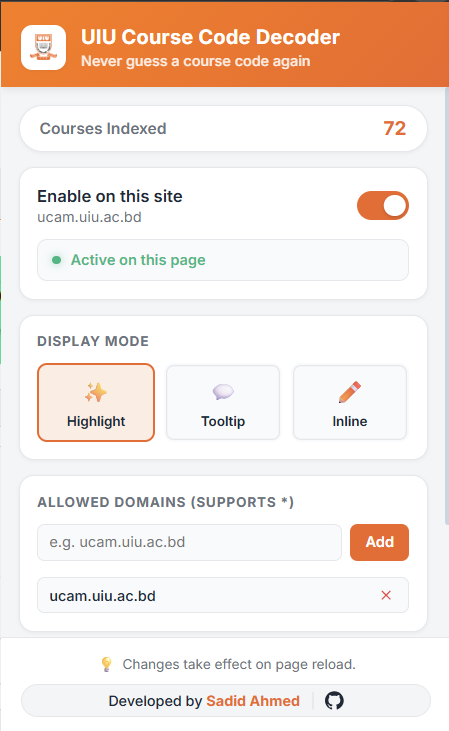
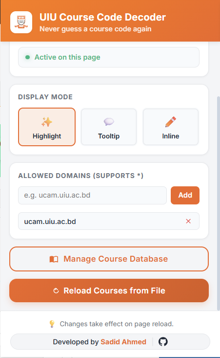
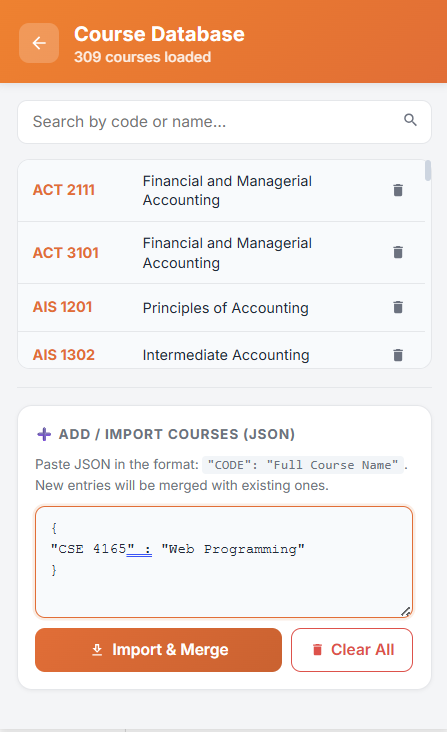
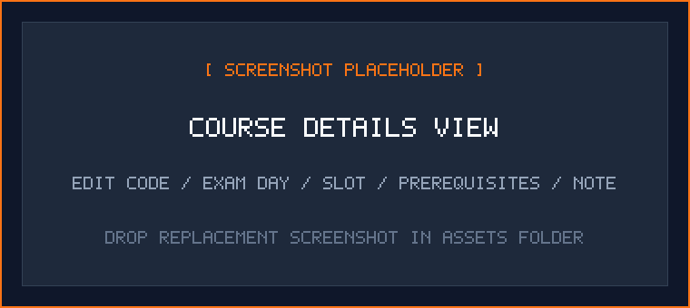
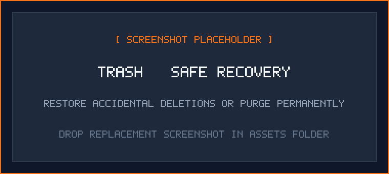
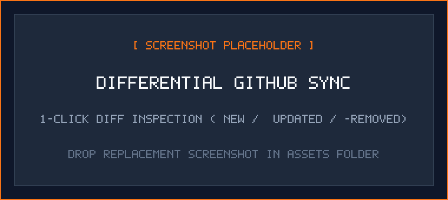

# UIU Course Code Decoder

> Instant, offline decoding of cryptic academic course codes into readable course titles, exam routines, and prerequisite chains across United International University (UIU) portals.

<div align="center">

[](manifest.json)
[](LICENSE)
[](PRIVACY.md)
[](SECURITY.md)
[](https://github.com/litch07/uiu-course-decoder)

</div>

<p align="center">
  
</p>
<p align="center"><em>Live decoding on the UIU student portal: cryptic codes are augmented in real time with course titles and routines.</em></p>

---

## Overview

During advising, registration, and final examinations, university portals frequently display short codes such as `CSE 3421`, `ACT 1111`, or `DS 3120` without course titles or schedules. Students often have to juggle multiple PDF routine sheets and advising guidelines just to verify a course name or check an exam slot.

**UIU Course Code Decoder** solves this by scanning web pages in real time and augmenting course codes with official academic details directly inside your browser:

- **Full Course Titles**: e.g., `CSE 3421` &rarr; **Database Management Systems**
- **Exam Routine Slots**: e.g., **Day A**, **Slot 1** (or custom departmental formats)
- **Direct Prerequisites**: e.g., **CSE 2213**
- **Special Credit Requirements**: e.g., **MINIMUM 85 credits** for capstone courses

### Supported Portals & Systems

| System | Domain | Decoding Coverage |
|---|---|---|
| **UCAM Student Portal** | `ucam.uiu.ac.bd` | Course registration, advising slips, class routines, grade sheets |
| **eLMS Platform** | `elms.uiu.ac.bd` | Moodle course dashboards, assignment listings, syllabus notices |
| **Routine Charts** | SVG / Highcharts | Exam schedules and grade distribution graphics rendered in SVG |
| **Spreadsheets & Docs** | `docs.google.com` | Official department routine sheets and advising guidelines |
| **Custom Webpages** | Any approved domain | Enable on any website via the extension popup toggle |

---

## Display Modes

Choose how decoded course details appear on your screen:

| Mode | Visual Presentation | Recommended Use Case |
|---|---|---|
| **Highlight** | Subtle accent underline under course codes. Hovering opens an interactive card with full details. | Default browsing during advising and course registration. |
| **Tooltip** | Webpage typography remains 100% untouched. Hovering over a code reveals the details card. | Clean document reading where you prefer no visual markers. |
| **Inline** | Appends the course title in parentheses directly into page text (e.g., `CSE 3715 (Software Engineering)`). | Fast glance reading and printing advising sheets without mouse interaction. |

<p align="center">
  
  
</p>
<p align="center"><em>Left: Interactive hover card with exam schedule and prerequisites. Right: Inline mode directly in page text.</em></p>

> [!TIP]
> You can also independently toggle **Exam Schedules** and **Prerequisites** on or off directly from the extension's home screen.

---

## Key Capabilities

- **Offline-First by Design**: Pre-loaded with a validated catalog of over 315 UIU courses spanning CSE, EEE, BBA, Data Science, and General Education. Decodes instantly with zero initial network connectivity.
- **Strict Privacy & Zero Telemetry**: Contains zero tracking scripts, analytics SDKs, or third-party cookies. All custom edits, preferences, and cached catalogs stay strictly inside your browser's `chrome.storage.local`.
- **Zero-`innerHTML` Security**: Programmed strictly with safe DOM APIs (`createElement`, `createTextNode`, `textContent`). Completely eliminates DOM-based Cross-Site Scripting (XSS) vectors.
- **Granular Per-Site Permissions**: Follows the principle of least privilege. The extension only executes on web domains you explicitly approve. Approved sites persist across page reloads via dynamic script registration (`chrome.scripting.registerContentScripts`).
- **Separation of Prerequisites & Degree Rules**: Course dependency chains (e.g., `CSE 2213`) are cleanly decoupled from institutional credit thresholds (e.g., `MINIMUM 85 credits`), ensuring accurate prerequisite matching.
- **Differential GitHub Sync**: Pull updates from the community-maintained catalog on GitHub with 1-click diff inspection (`+X new`, `~X updated`, `-X removed`) before committing changes locally.
- **Layered Data Architecture**: Add unlisted courses, override exam slots, or import batch JSON catalogs (with an enforced 2 MB safety limit). Custom modifications survive official catalog updates.
- **Safe Trash & Recovery**: Soft-delete courses to a dedicated Trash panel where they can be restored at any time or permanently purged.
- **One-Click Issue Reporting**: Spot outdated information? Click **Report Wrong Data** in the Course Details view to open an automated, pre-formatted GitHub issue for maintainers.

---

## Enabling on University Websites

To ensure privacy and avoid unnecessary background execution, the extension uses an optional per-site permission model:

1. Navigate to your university portal (such as [UCAM](https://ucam.uiu.ac.bd) or [eLMS](https://elms.uiu.ac.bd)).
2. Click the **UIU Course Code Decoder** icon in your browser toolbar.
3. Switch the **Active on this page** toggle to **ON**.
4. Confirm the browser permission prompt for that domain.
5. All course codes on the page will decode immediately and will persist across all future visits.
6. You can review, add, or revoke authorized domains anytime from the **Settings** view.

<p align="center">
  
  
</p>
<p align="center"><em>Left: Home view with one-click site activation. Right: Global display mode preferences and toggles.</em></p>

---

## Course Database Management

The extension includes a complete built-in management interface accessible directly from the popup:
- **Search & Filter**: Search by course code or title, and filter by origin (Official, User Added, or Edited).
- **Course Details View**: Inspect code, title, exam routine, prerequisites, and degree requirements.
- **Batch Upload**: Import course lists in JSON format with live syntax validation and sample copying.
- **Safe Trash Panel**: Accidental deletions can be restored anytime or permanently purged.
- **Differential Sync**: Inspect remote updates before merging.

<p align="center">
  
  
</p>
<p align="center"><em>Left: Course Database list with real-time search. Right: Course Details view with edit controls.</em></p>

<p align="center">
  
  
</p>
<p align="center"><em>Left: Batch JSON import with live detection badge. Right: Trash and recovery management.</em></p>

<p align="center">
  
</p>
<p align="center"><em>Differential sync: Inspect added, updated, and removed courses before applying official updates.</em></p>

---

## Installation

### Chrome, Edge, Brave, and Chromium Browsers

1. Clone or download this repository:
   ```bash
   git clone https://github.com/litch07/uiu-course-decoder.git
   ```
2. Open your browser and navigate to `chrome://extensions`.
3. Enable **Developer mode** via the toggle in the upper-right corner.
4. Click **Load unpacked** and select the extension directory.
5. Pin the extension icon to your browser toolbar for quick access.

### Firefox

1. Open Firefox and navigate to `about:debugging#/runtime/this-firefox`.
2. Click **Load Temporary Add-on...**.
3. Select `manifest.json` from the root of this repository.

---

## Project Structure

```
├── manifest.json              # Manifest V3 configuration & optional host permissions
├── content.js                 # DOM scanning, SVG/Highcharts handler, zero-innerHTML renderer
├── background.js              # Service worker: dynamic script registration, catalog merge, GitHub sync
├── popup.html                 # 5-view sliding stack UI (Home, Courses, Details, Import, Settings)
├── popup.js                   # UI state controller, search engine, dynamic permissions, issue prefill
├── popup.css                  # Stylesheet, transitions, dark tokens, reduced-motion queries
├── courses.json               # Baseline university catalog (~315 courses)
├── assets/                    # Screenshots, previews, and documentation graphics
├── tests/                     # Automated unit and integration test suite
│   ├── test_release1.js       # Release 1 verification suite (Security, permissions, schema)
│   ├── test_merge.js          # Layered catalog merge tests
│   ├── test_sync_diff.js      # Differential sync diff tests
│   └── ...                    # Additional unit and regression tests
├── .github/workflows/         # CI: automated catalog validation & test runner
├── SECURITY.md                # Vulnerability disclosure policy & security model
├── PRIVACY.md                 # Complete transparent privacy documentation
└── CONTRIBUTING.md            # Contribution guide and course schema specification
```

---

## Verification & Testing

The repository contains an automated test suite verifying data integrity, security constraints, and storage operations:

```bash
# Run the Release 1 verification suite
node tests/test_release1.js

# Run the complete test suite
Get-ChildItem tests/test_*.js | ForEach-Object { node $_.FullName }
```

Every Pull Request is automatically verified by GitHub Actions via [`.github/workflows/validate-catalog.yml`](.github/workflows/validate-catalog.yml).

---

## Contributing

Contributions to expand department course catalogs or improve extension functionality are welcome:

- **Quick Corrections**: Open any course in the extension popup and click **Report Wrong Data**.
- **Adding Courses & Features**: Review [`CONTRIBUTING.md`](CONTRIBUTING.md) for the data schema specification, formatting rules, and step-by-step submission workflows.

---

## License

This project is open-source under the [MIT License](LICENSE).  
Maintained by [Sadid Ahmed](https://github.com/litch07) for the UIU community.
