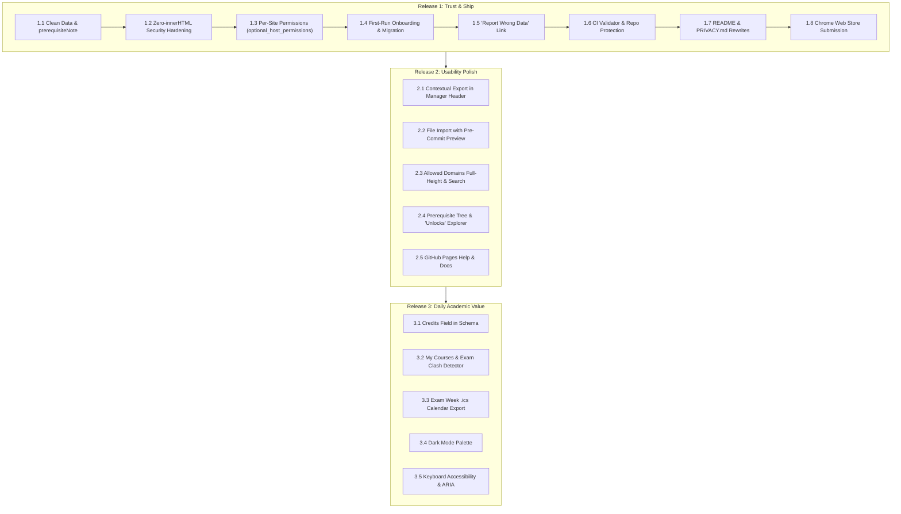

# UIU Course Code Decoder — Feature Planning & Engineering Roadmap

## Executive Summary
This roadmap establishes the structured release plan for the **UIU Course Code Decoder** Chrome extension across three focused milestones. It prioritizes **security, trust, and data integrity** before public Chrome Web Store distribution, followed by **workflow polish** and **high-impact daily academic utilities** (exam clash detection and prerequisite chain tracking).

---

---

## Milestone 1: Release 1 — Trust & Ship
*Primary Goal: Harden the existing codebase, eliminate invasive permission warnings, ensure data purity, and prepare for Chrome Web Store approval.*

### 1.1 Data Normalization & `prerequisiteNote` Field
- **Problem**: The catalog contains 5 entries where credit constraints (`"MINIMUM COMPLETED CREDIT 70"`, `"minimum 85 credits"`) were stored inside the `prerequisites` array. Treating non-course strings as course codes breaks dependency graph resolution.
- **Implementation**:
  - Add optional `prerequisiteNote: string` to the course schema.
  - Migrate the 5 affected courses in `courses.json` (`CSE 4000A`, `CSE 4451`, `DS 3120`, `DS 4000A`, `DS 4123`).
  - Empty their `prerequisites` arrays so `prerequisites` strictly contains valid course codes.
  - Update `popup.html` and `popup.js` form controls to support `prerequisiteNote`.
  - Update batch upload parser and test suites.

### 1.2 Zero-`innerHTML` Security Hardening
- **Problem**: `content.js` currently uses `wrap.innerHTML = buildInlineHtml(...)` and `globalTooltip.innerHTML = buildTooltipHtml(...)`. Chrome Web Store automated security analyzers scrutinize `innerHTML` in content scripts because community-supplied course names could potentially become XSS vectors.
- **Implementation**:
  - Refactor `renderTooltip` and `renderInline` in `content.js` to use pure DOM element construction (`document.createElement`, `document.createTextNode`, `textContent`).
  - Eliminate all `innerHTML` and `insertAdjacentHTML` across `content.js`.
  - Enforce strict regex character escaping for all course codes in `buildRegex`.
  - Add size limits (max 2 MB) and schema validation checks on both local imports and remote sync payloads.

### 1.3 Per-Site Permissions Model
- **Problem**: `manifest.json` currently requests `host_permissions: ["<all_urls>", ...]`. This triggers the alarming install warning: *"Can read and change your data on all websites"*, causing student hesitation and store rejection risk.
- **Implementation**:
  - Remove `<all_urls>` from `host_permissions`.
  - Add `optional_host_permissions: ["*://*/*"]` (or target UIU wildcards).
  - When a user enables a site, call `chrome.permissions.request({ origins: [origin] })`.
  - Register content scripts dynamically using `chrome.scripting.registerContentScripts` (or `chrome.scripting.executeScript`).
  - Provide permission status checks to seamlessly handle revocations.

### 1.4 First-Run Onboarding & Saved Sites Re-Grant
- **Problem**: New users install the extension and see nothing happen because no sites are enabled by default. Existing users updating from Firefox/Edge have saved sites that will need permission grants under the new model.
- **Implementation**:
  - **First-Run Welcome Card**: Shows on first popup open with one-click enablement for standard UIU portals:
    - `ucam.uiu.ac.bd` (Registration & Routine)
    - `elms.uiu.ac.bd` (Moodle LMS)
    - Optional checkbox for `docs.google.com` (embedded routine spreadsheets)
  - **Re-Grant Banner**: For users with previously saved sites in `chrome.storage.local`, show a single-click "Grant access to your N saved sites" banner.

### 1.5 "Report Wrong Data" Crowdsourcing
- **Implementation**:
  - Add a subtle "Report data issue" link/button in the Course Details view (`details-view`).
  - Clicking constructs a pre-filled GitHub issue URL (`https://github.com/litch07/uiu-course-decoder/issues/new?title=...&body=...`) containing the course code, existing name, exam day, slot, and prerequisites.
  - Collects zero user telemetry; opens directly in a new tab.

### 1.6 Supply Chain Protection & Repository Governance
- **Implementation**:
  - Create a GitHub Action workflow (`.github/workflows/validate-catalog.yml`) that validates `courses.json` syntax, checks for broken prerequisite links, and runs all 10 automated test suites on every pull request.
  - Enable GitHub branch protection on `main` requiring automated checks and code review.
  - Add `SECURITY.md` defining responsible disclosure guidelines.
  - Publish formalized SemVer tagged releases with changelogs.

### 1.7 Documentation & Privacy Policy Rewrites
- **Implementation**:
  - Rewrite `PRIVACY.md` to accurately disclose the user-initiated GitHub sync endpoint (`https://raw.githubusercontent.com/*`) and document the per-site permission model.
  - Rewrite `README.md` to highlight Chrome Web Store availability, installation instructions, high-resolution screenshots, and real architectural capabilities.

### 1.8 Chrome Web Store Submission
- **Implementation**:
  - Package clean ZIP artifact without test files, git metadata, or scratch files.
  - Prepare store listing copy, justification statements for permissions, and promotional screenshots.
  - Submit for review.

---

## Milestone 2: Release 2 — Usability Polish
*Primary Goal: Streamline routine catalog operations, prevent data loss during imports, and deliver rich prerequisite visualization.*

### 2.1 Contextual Export in Course Manager Header
- **Specification**: Exactly one Export button located in the Course Manager list header beside the search/filter controls.
- **Behavior**: Exports whatever courses are currently visible under active filters (e.g. All, User-Added, Edited) as a formatted `.json` file matching the official import schema.
- **No Redundancy**: Omits redundant export buttons from Settings or Import tabs. Uses local Blob download (no `chrome.storage.sync` to maintain local-only promise).

### 2.2 File Import with Pre-Commit Diff Preview
- **Specification**: Add "Choose .json file" and drag-and-drop file ingestion to the Batch Upload tab.
- **Safety Diff Preview**: Before merging into `chrome.storage.local`, present an interactive confirmation modal showing:
  - `X new courses to add`
  - `Y courses that will overwrite your custom edits`
  - `Z invalid entries skipped`
- **File Validation**: Restrict file extension to `.json`, enforce 2 MB cap, and validate each object schema.

### 2.3 Allowed Domains Full-Height Management & Search
- **Specification**:
  - Expand the Allowed Domains container in Settings to utilize available screen height without artificial micro-scrollboxes.
  - Display site counter: `Allowed Sites (${count})`.
  - Add search input when allowlist exceeds 5 entries.
  - Display inline warning badges when users enter overly broad wildcards (e.g., `*` or `*.com`).

### 2.4 Prerequisite Chain & Reverse "Unlocks" Explorer
- **Location**: Course Details page (`details-view`).
- **Features**:
  - **Forward Chain**: Collapsible tree tracing prerequisite dependencies down to foundational courses (e.g., `CSE 3421` $\rightarrow$ `CSE 2215` $\rightarrow$ `CSE 1111` $\rightarrow$ `CSE 1110`).
  - **Cycle Guard**: Visited-set algorithm preventing infinite loops on circular definitions.
  - **Reverse Chain ("Unlocks")**: Inverted index displaying which courses require this course as a prerequisite (essential for trimester pre-advising).
  - **Non-Course Display**: Shows `prerequisiteNote` prominently at the top of the tree.

### 2.5 GitHub Pages Documentation & External Help Site
- **Specification**: Host complete user documentation, FAQ, visual walkthroughs, and contributor guides in `docs/` published via GitHub Pages.
- **Popup Integration**: Single "Help & Documentation" link in Settings pointing to the external site, keeping the extension package lightweight.

---

## Milestone 3: Release 3 — Daily Academic Value
*Primary Goal: Transform the extension from a passive course name dictionary into an indispensable student companion during registration and exam periods.*

### 3.1 Course Schema Expansion: `credits` Field
- **Specification**: Add `credits: number` (e.g., `3`, `1`, `2`) to the database schema.
- **Source**: Ingest from existing university course offering CSVs.
- **UI Exposure**: Display credits in Course Details, Course Manager table, and hover tooltips.

### 3.2 "My Courses" Tracker & Exam Clash Detection
- **Specification**:
  - Allow students to bookmark or "star" their 3–5 enrolled courses for the active trimester.
  - **Conflict Analysis Engine**: Automatically cross-references Exam Day (`D1-D8`) and Exam Slot (`T1-T3`) across all starred courses.
  - **Real-Time Warning Banner**: Flags conflicts during advising:
    > `⚠️ Exam Routine Clash: CSE 3421 and MATH 2205 share Day 2, Slot T2.`

### 3.3 Exam Week Schedule & Calendar Export (`.ics`)
- **Specification**:
  - Generates a dedicated chronological exam schedule for the student's starred courses.
  - One-click `.ics` export generating an iCalendar file compatible with Google Calendar, Apple Calendar, and Outlook.

### 3.4 Dark Mode Palette
- **Specification**:
  - Complete dark theme for the extension popup and in-page tooltip cards.
  - Follows system preference (`prefers-color-scheme: dark`) with manual override in Settings.
  - Accessible contrast ratios complying with WCAG AA standards.

### 3.5 Keyboard Accessibility & Screen Reader (ARIA)
- **Specification**:
  - Make in-page decoded course tags focusable (`tabindex="0"`).
  - Display tooltips upon keyboard focus.
  - Complete ARIA labelling across popup navigation buttons, search inputs, and modal dialogues.

---

## Explicit Non-Goals (What We Will NOT Build)
To preserve the extension's core identity—**fast, private, and local-first**—the following features are intentionally out of scope:
1. **User Accounts & Cloud Auth**: No sign-in or user tracking.
2. **Third-Party Telemetry & Analytics**: Zero tracking scripts.
3. **AI / LLM Integration**: Rule-based lookups and tree traversal are instantaneous and 100% deterministic.
4. **Background Scraping / Polling**: Network calls are strictly user-initiated.
5. **Configurable Sync Endpoints**: Syncing is restricted strictly to the verified official repository to avoid untrusted code execution.

---

## Progress Tracking Matrix

| Feature | Release | Status | Priority |
|---|---|---|---|
| 1.1 Data Normalization & `prerequisiteNote` | R1 | **Pending** | Critical |
| 1.2 Zero-`innerHTML` Security Hardening | R1 | **Pending** | Critical |
| 1.3 Per-Site Permissions Architecture | R1 | **Pending** | Critical |
| 1.4 First-Run Onboarding & Re-Grant Banner | R1 | **Pending** | High |
| 1.5 "Report Wrong Data" Action | R1 | **Pending** | Medium |
| 1.6 CI Validator & Repository Protection | R1 | **Pending** | High |
| 1.7 Documentation & Privacy Policy Rewrites | R1 | **Pending** | High |
| 1.8 Chrome Web Store Submission | R1 | **Pending** | Final |
| 2.1 Contextual Single Export | R2 | Scheduled | Medium |
| 2.2 File Import with Pre-Commit Preview | R2 | Scheduled | Medium |
| 2.3 Allowed Domains Full-Height & Search | R2 | Scheduled | Medium |
| 2.4 Prerequisite Tree & "Unlocks" Explorer | R2 | Scheduled | High |
| 2.5 GitHub Pages Documentation Site | R2 | Scheduled | Low |
| 3.1 Course Credits Schema Expansion | R3 | Future | Low |
| 3.2 My Courses & Exam Clash Detector | R3 | Future | High |
| 3.3 Exam Week Schedule & `.ics` Export | R3 | Future | Medium |
| 3.4 Dark Mode Palette | R3 | Future | Medium |
| 3.5 Keyboard Accessibility & ARIA Support | R3 | Future | Medium |

