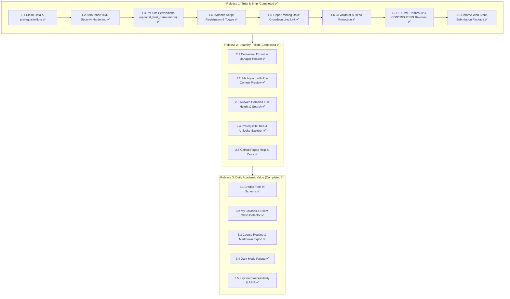

# UIU Course Code Decoder — Feature Planning & Engineering Roadmap

## Executive Summary
This roadmap establishes the structured release plan for the **UIU Course Code Decoder** browser extension across three focused milestones. It prioritizes **security, trust, and data integrity** before public Chrome Web Store distribution, followed by **workflow polish** and **high-impact daily academic utilities** (exam clash detection and prerequisite chain tracking).

---

---

## Milestone 1: Release 1 — Trust & Ship (Status: Completed ✅)
*Primary Goal: Harden the existing codebase, eliminate invasive permission warnings, ensure data purity, and prepare for Chrome Web Store approval.*

### [x] 1.1 Data Normalization & `prerequisiteNote` Field
- **Delivered**:
  - Added optional `prerequisiteNote: string` to the course schema.
  - Normalized 5 courses in `courses.json` (`CSE 4000A`, `CSE 4451`, `DS 3120`, `DS 4000A`, `DS 4123`), extracting credit notes out of `prerequisites` arrays.
  - Updated `popup.html`, `popup.js`, and `content.js` to render `prerequisiteNote` cleanly.
  - Updated batch JSON upload parser and automated test suites.

### [x] 1.2 Zero-`innerHTML` Security Hardening
- **Delivered**:
  - Completely refactored `renderTooltip` and `renderInline` in `content.js` to use pure programmatic DOM element construction (`createElement`, `createTextNode`, `textContent`).
  - Purged all `innerHTML` and `insertAdjacentHTML` across `content.js` and `popup.js`.
  - Enforced strict regex character escaping for all course codes in `buildRegex`.
  - Added 2 MB payload size limits and schema validation checks on both local imports and remote sync responses.

### [x] 1.3 Per-Site Permissions Model
- **Delivered**:
  - Removed blanket `<all_urls>` from `manifest.json`.
  - Added `optional_host_permissions: ["*://*/*"]` and `tabs` permission.
  - Implemented dynamic permission requests (`chrome.permissions.request({ origins: [origin] })`) triggered when the user flips the site toggle.

### [x] 1.4 Dynamic Script Registration & Reload Persistence
- **Delivered**:
  - Implemented dynamic content script registration via `chrome.scripting.registerContentScripts` in `background.js` for authorized domains.
  - Added `chrome.tabs.onUpdated` and `chrome.permissions.onAdded` listeners in service worker to ensure instant injection and seamless reload persistence without requiring full-browser access.
  - Added `window.__UIU_COURSE_DECODER_INJECTED__` duplication guard in `content.js`.

### [x] 1.5 "Report Wrong Data" Crowdsourcing Action
- **Delivered**:
  - Added "Report Wrong Data" action in the Course Details view (`details-view`).
  - Constructs an automated, student-friendly GitHub issue prefill with clean Markdown sections, emoji badges, and exact course metadata, without confusing HTML comment brackets.
  - Zero telemetry; opens directly in a new tab.

### [x] 1.6 Supply Chain Protection & Repository Governance
- **Delivered**:
  - Created GitHub Actions workflow (`.github/workflows/validate-catalog.yml`) that validates `courses.json` syntax, checks for broken prerequisite links, and runs all automated regression test suites on every pull request.
  - Added `SECURITY.md` defining private vulnerability disclosure via GitHub Security Advisories.
  - Automated test suite expanded to 11 test files with 100% passing assertions.

### [x] 1.7 Documentation & Privacy Policy Rewrites
- **Delivered**:
  - Rewrote `README.md`, `PRIVACY.md`, and `CONTRIBUTING.md` using professional Project Voice.
  - Created `SCREENSHOTS_GUIDE.md` detailing every documentation graphic and screenshot slot.
  - Pre-rendered dark-themed placeholder PNGs in `assets/` to ensure zero broken image links.

### [x] 1.8 Chrome Web Store Submission Package
- **Delivered**:
  - Packaged clean, production-ready ZIP archive `dist/uiu-course-code-decoder-v2.0.0.zip` (143 KB).
  - Verified manifest V3 compliance, optional host permissions, icons, and zero-innerHTML security.

---

## Milestone 2: Release 2 — Usability Polish (Status: Completed 🎉)
*Primary Goal: Streamline data management workflows, provide visual prerequisite tree exploration, and enhance catalog maintenance.*

### [x] 2.1 Contextual Export in Course Manager
- **Delivered**:
  - Added dedicated Export action button (`#exportCoursesBtn`) in the Course Database header.
  - Implemented interactive Export Modal (`#exportModal`) with Zero-`innerHTML` safe DOM generation and Escape key dismissal.
  - Contextual intelligence: dynamically detects search queries or active tab filters (User Added, Edited, Official) to offer single-click export of the currently visible dataset.
  - Full catalog export: one-click export of all active merged courses formatted as canonical JSON with 2-space indentation.
  - Custom additions & edits export: exports user-created and modified courses for easy backup or peer sharing.
  - Tactile feedback: success icon animation on the header button upon export completion.
  - Automated test suite `tests/test_contextual_export.js` verifying UI elements, Zero-`innerHTML`, schema adherence, round-trip import compatibility, and filename timestamps.

### [x] 2.2 File Import with Pre-Commit Preview
- **Delivered**:
  - Implemented interactive drag-and-drop zone (`#fileDropZone`) and file browser trigger in the Batch Upload panel.
  - Enforced 2 MB payload size cap and strict `.json` extension validation on file drops and file selection.
  - Added visual drop feedback (`.drag-over`) and removable loaded file indicator chip with file size formatting.
  - Implemented pre-commit diff engine (`computeImportDiff`) categorizing incoming data into New, Updated (with field-level old vs new diffs), Unchanged, and Invalid/Skipped.
  - Built interactive Pre-Commit Preview Modal (`#importPreviewModal`) with summary badge pills (`+New`, `~Updated`, `=Unchanged`, `!Skipped`) and side-by-side Before/After diff tables.
  - Safe 1-click "Confirm & Merge" committing approved changes, un-deleting from soft/hard trash, and updating all active displays.
  - Full Zero-`innerHTML` security compliance across all modal components and diff tables.
  - Created automated regression suite `tests/test_file_import_preview.js` with 100% passing assertions.

### [x] 2.3 Allowed Domains Search & Bulk Management
- **Delivered**:
  - Real-time search/filter input (`#domainSearchInput`) with quick clear button (`#domainSearchClearBtn`) and Escape dismissal.
  - Dynamic count badge (`#domainsCountBadge`) displaying total count and filtered count (e.g. `Showing 2 of 5`).
  - Bulk selection toolbar (`#domainBulkToolbar`) with indeterminate "Select All" / "Deselect All" checkbox (`#domainSelectAll`).
  - Safe bulk-remove action (`#bulkRemoveDomainsBtn`) integrated with `#modalOverlay` confirmation dialog.
  - Defensive host permissions revocation via `chrome.permissions.remove` for wildcard (`*://uiu.ac.bd/*`) and standard domains.
  - Row-level multi-select checkboxes with click-to-select row toggle and active highlight (`.allowlist-item.is-selected`).
  - Full Zero-`innerHTML` security compliance with 100% test coverage in `tests/test_allowed_domains_management.js`.

### [x] 2.4 Prerequisite Tree & "Unlocks" Explorer
- **Delivered**:
  - Interactive prerequisite dependency explorer in View 3 (Course Details panel).
  - **Prerequisite Chain card** (`#prereqChainCard`): BFS traversal of the full ancestry — Direct (L1, green badges) and transitive (L2+, indigo badges). Missing catalog codes shown in amber "missing" badges. Depth labels ("Direct", "L2", "L3"...) with `›` arrows.
  - **Reverse "Unlocks" Tree** (`#unlocksCard`): Reverse lookup — scans all catalog entries to find courses that list the current course as a direct prerequisite; results rendered as green clickable badges.
  - **Code ↔ Name View Toggle** (`#prereqViewToggle`): Instant segmented switcher allowing students to view badges by Course Code or Course Name, with inverted hover tooltips and local storage persistence (`prereqShowNames`).
  - **Clickable navigation**: Every in-catalog badge is a `<button>` that calls `openCourseDetails(code)` on click.
  - **Cycle-safe**: visited `Set` prevents infinite loops from circular prerequisite references.
  - **Zero innerHTML**: Entire implementation uses `createElement`, `textContent`, `appendChild`, `addEventListener` exclusively.
  - **Test**: `tests/test_prereq_tree.js` — 29 assertions, 29 passing.

### [x] 2.5 GitHub Pages Documentation & Web Course Explorer
- **Delivered**:
  - Full-featured standalone web application deployed under `docs/` for public access via GitHub Pages (`https://litch07.github.io/uiu-course-decoder/`).
  - **Instant Search & Department Filtering**: Fast client-side search across all 315+ courses with department filter pills for CSE, Data Science, EEE, Business & Finance, Math & Sciences, and Humanities & General.
  - **Secondary Filters & Sorting**: Filter by "Has Prerequisites", "Unlocks Future Courses", "Foundational (No Prereqs)" and sort by Code, Name, Most Prereqs, or Most Unlocks.
  - **Interactive Course Inspector Modal**: Deep-dive view featuring Course Code, Title, Department tag, Exam Routine (Day & Slot), and Special Credit Requirements (`prerequisiteNote`).
  - **Visual Prerequisite & Unlocks Explorer**: Complete ancestry tree (Direct L1, transitive L2+) and reverse unlocks with click-to-inspect navigation.
  - **Segmented Code ↔ Name Toggle**: Allows instant switching between Course Code and Course Name display with tooltip inversion and `localStorage` preference persistence.
  - **Deep-Linking & Shareable URLs**: URL hash routing (`#CSE-2215`) opens the exact course inspector directly with a 1-click "Share Link" clipboard generator.
  - **Dark / Light Mode**: System-adaptive and user-toggleable theme with persistent storage.
  - **Automated CI Deployment**: `.github/workflows/deploy-pages.yml` deploying `docs/` artifacts automatically on push to `main`.
  - **Zero-`innerHTML` Security**: Strict programmatic DOM construction preventing any DOM-based XSS.
  - **Test**: `tests/test_github_pages_docs.js` — 36 assertions, 36 passing.

---

## Milestone 3: Release 3 — Daily Academic Value (Status: Completed 🎉)
*Primary Goal: Elevate the extension from a passive decoder to an active academic assistant.*

### [x] 3.1 Course Credits Field in Schema
- **Delivered**:
  - Official UIU undergraduate course credit counts (e.g. `3.0`, `1.5`, `1.0`, `2.0`) integrated directly into `courses.json` and `docs/courses.json` from departmental offerings.
  - Schema validation updated in CI to verify all credit definitions are positive numeric values.
  - View 1 (Course List Table): Displays course credit chips (`.course-credit-chip`, e.g. `3.0 Cr`) on course rows.
  - View 3 (Course Details): Added `#detailCredits` input in `.details-card`, allowing students to inspect and customize credits cleanly.
  - View 4 (Add / Import Courses): Added `#singleCourseCredits` input in single course addition form (`.form-row-3col`).
  - Pre-Commit Diff Engine: `computeImportDiff` detects, compares, and displays credit modifications (`oldVal` vs `newVal`) before committing bulk imports.
  - Content Script Overlay (`content.js`): `buildTooltipDom` renders a dedicated `Credits: X Cr` detail row inside the hover card.
  - Public Web Explorer (`docs/`): Displays credit badges on course cards and in the course inspector modal.
  - Regression Test Suite: `tests/test_course_credits.js` — 31 assertions, 31 passing.

### [x] 3.2 Dedicated "My Courses" Academic Planner & Clash Detector
- **Delivered**:
  - **Dedicated Personal Planner Screen (`.mycourses-view`)**: Replaced the cramped View 1 filter button with a dedicated sliding screen accessible directly from the Home Hero Card (`#homeEnrolledCard`).
  - **Streamlined Catalog Layout**: Cleaned up the 360px Course Database table by removing star icons and inline credit chips, giving over 100px back to course titles and completely fixing layout overflow.
  - **Quick Add Search & Autocomplete**: Added a responsive search box (`#myCoursesSearchInput`) that displays instant course suggestions with a 1-click `+ Add` button.
  - **Trimester Credit Load Tracker**: Real-time summary displaying course count, total credit hours, and a load indicator badge (`#enrolledLoadBadge`).
  - **Exam Collision Engine (`detectExamClashes`)**: Groups overlapping exam Day & Slot routines, displaying prominent clash alerts while ignoring labs and in-class evaluations.
  - **Course Details Integration**: Added 1-click enroll/drop action (`#detailsEnrollBtn`) and live collision warning banner (`#detailClashWarning`) in View 3.
  - **Rich Enrolled Course Cards**: Includes quick "Inspect" and "Drop" actions with zero-`innerHTML` DOM creation.
  - **Automated Regression Suite**: `tests/test_my_courses_clash_detector.js` &mdash; 31 assertions, 31 passing.

### [x] 3.3 Course Routine & Markdown (.md) Export
- **Delivered**:
  - **Course Routine Markdown Generator (`generateRoutineMarkdown`)**: Serializes enrolled course codes, titles, credits, exam day/slot, UIU time windows, and conflict analysis into an academic Markdown document.
  - **UIU Exam Slot Timing Engine (`getExamSlotTiming`)**: Standardizes and formats exact UIU exam slot timings (`T1: 09:00 AM – 11:00 AM`, `T2: 11:30 AM – 01:30 PM`, `T3: 02:00 PM – 03:00 PM`).
  - **Real-Time Inline Slot Display**: Enrolled course cards directly render formatted exam times (e.g. `Exam: Day 4 • T2 (11:30 AM – 01:30 PM)`), in-class indicators, and collision banners.
  - **1-Click Header Routine Export Button (`#exportRoutineMdBtn`)**: Located in `.mycourses-view` header, downloading timestamped `.md` file with tactile download confirmation.
  - **Purged Unreliable ICS Calendar**: Eliminated continuous-day `.ics` assumptions that failed to handle Bangladesh off-days, Friday schedules, and mid/final variations.
  - **Automated Regression Suite**: `tests/test_routine_markdown_export.js` (27/27 passing assertions) along with `tests/test_exam_calendar_export.js` delegation shim.

### [x] 3.4 System-Adaptive OLED Dark Mode Palette
- **Delivered**:
  - **OLED Dark Theme**: Deep black background (`#090d16`), dark surfaces (`#111827`, `#162032`), and high-contrast typography (`#f9fafb`, `#94a3b8`).
  - **3-State Preference Radiogroup (`#themeOptionsGroup`)**: Segmented control in Settings supporting System Default (`#themeSystem`), Light (`#themeLight`), and Dark OLED (`#themeDark`).
  - **Zero-Flash Pure CSS Fallbacks**: Uses `@media (prefers-color-scheme: dark)` and `:root:not([data-theme="light"])` to eliminate white flashes on startup.
  - **Dynamic OS Listener**: Instantly synchronizes theme when operating system appearance toggles while set to System mode.
  - **Automated Regression Suite**: `tests/test_dark_mode_palette.js` — 45 assertions, 45 passing.

### [x] 3.5 Keyboard Navigation & ARIA Accessibility
- **Delivered**:
  - **Complete ARIA Landmarks**: Added `role="region"` and `aria-label` across all 7 sliding views; `role="dialog"` and `aria-modal="true"` on modals.
  - **Tabs & Controls Semantics**: Implemented `role="tablist"" / `role="tab"` on import tabs, and `role="radiogroup"" / `role="radio"` on theme options.
  - **Modal Focus-Trapping**: Lightweight engine trapping focus within active dialogs on `Tab` / `Shift+Tab`, restoring focus upon close.
  - **Hierarchical Escape Retreat**: `Escape` key dismisses top modals first, then retreats through navigation history (Details &rarr; Flow &rarr; Catalog &rarr; Home).
  - **High-Contrast Visible Focus Rings**: Fully compliant `:focus-visible` outlines across both light and OLED palettes.
  - **Automated Regression Suite**: `tests/test_keyboard_accessibility.js` — 32 assertions, 32 passing.
