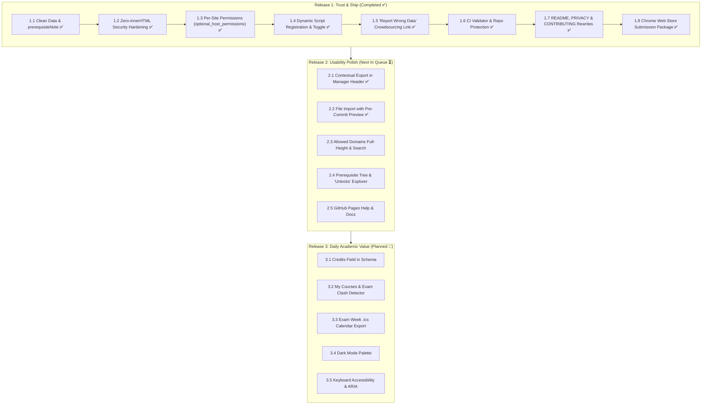

# UIU Course Code Decoder — Feature Planning & Engineering Roadmap

## Executive Summary
This roadmap establishes the structured release plan for the **UIU Course Code Decoder** browser extension across three focused milestones. It prioritizes **security, trust, and data integrity** before public Chrome Web Store distribution, followed by **workflow polish** and **high-impact daily academic utilities** (exam clash detection and prerequisite chain tracking).

---

---

## Milestone 1: Release 1 — Trust & Ship (Status: Completed ✅)
*Primary Goal: Harden the existing codebase, eliminate invasive permission warnings, ensure data purity, and prepare for Chrome Web Store approval.*

### [x] 1.1 Data Normalization & `prerequisiteNote` Field
- **Delivered**:
  - Added optional `prerequisiteNote: string` to the course schema.
  - Normalized 5 courses in `courses.json` (`CSE 4000A`, `CSE 4451`, `DS 3120`, `DS 4000A`, `DS 4123`), extracting credit notes out of `prerequisites` arrays.
  - Updated `popup.html`, `popup.js`, and `content.js` to render `prerequisiteNote` cleanly.
  - Updated batch JSON upload parser and automated test suites.

### [x] 1.2 Zero-`innerHTML` Security Hardening
- **Delivered**:
  - Completely refactored `renderTooltip` and `renderInline` in `content.js` to use pure programmatic DOM element construction (`createElement`, `createTextNode`, `textContent`).
  - Purged all `innerHTML` and `insertAdjacentHTML` across `content.js` and `popup.js`.
  - Enforced strict regex character escaping for all course codes in `buildRegex`.
  - Added 2 MB payload size limits and schema validation checks on both local imports and remote sync responses.

### [x] 1.3 Per-Site Permissions Model
- **Delivered**:
  - Removed blanket `<all_urls>` from `manifest.json`.
  - Added `optional_host_permissions: ["*://*/*"]` and `tabs` permission.
  - Implemented dynamic permission requests (`chrome.permissions.request({ origins: [origin] })`) triggered when the user flips the site toggle.

### [x] 1.4 Dynamic Script Registration & Reload Persistence
- **Delivered**:
  - Implemented dynamic content script registration via `chrome.scripting.registerContentScripts` in `background.js` for authorized domains.
  - Added `chrome.tabs.onUpdated` and `chrome.permissions.onAdded` listeners in service worker to ensure instant injection and seamless reload persistence without requiring full-browser access.
  - Added `window.__UIU_COURSE_DECODER_INJECTED__` duplication guard in `content.js`.

### [x] 1.5 "Report Wrong Data" Crowdsourcing Action
- **Delivered**:
  - Added "Report Wrong Data" action in the Course Details view (`details-view`).
  - Constructs an automated, student-friendly GitHub issue prefill with clean Markdown sections, emoji badges, and exact course metadata, without confusing HTML comment brackets.
  - Zero telemetry; opens directly in a new tab.

### [x] 1.6 Supply Chain Protection & Repository Governance
- **Delivered**:
  - Created GitHub Actions workflow (`.github/workflows/validate-catalog.yml`) that validates `courses.json` syntax, checks for broken prerequisite links, and runs all automated regression test suites on every pull request.
  - Added `SECURITY.md` defining private vulnerability disclosure via GitHub Security Advisories.
  - Automated test suite expanded to 11 test files with 100% passing assertions.

### [x] 1.7 Documentation & Privacy Policy Rewrites
- **Delivered**:
  - Rewrote `README.md`, `PRIVACY.md`, and `CONTRIBUTING.md` using professional Project Voice.
  - Created `SCREENSHOTS_GUIDE.md` detailing every documentation graphic and screenshot slot.
  - Pre-rendered dark-themed placeholder PNGs in `assets/` to ensure zero broken image links.

### [x] 1.8 Chrome Web Store Submission Package
- **Delivered**:
  - Packaged clean, production-ready ZIP archive `dist/uiu-course-code-decoder-v2.0.0.zip` (143 KB).
  - Verified manifest V3 compliance, optional host permissions, icons, and zero-innerHTML security.

---

## Milestone 2: Release 2 — Usability Polish (Status: In Progress ⏳)
*Primary Goal: Streamline data management workflows, provide visual prerequisite tree exploration, and enhance catalog maintenance.*

### [x] 2.1 Contextual Export in Course Manager
- **Delivered**:
  - Added dedicated Export action button (`#exportCoursesBtn`) in the Course Database header.
  - Implemented interactive Export Modal (`#exportModal`) with Zero-`innerHTML` safe DOM generation and Escape key dismissal.
  - Contextual intelligence: dynamically detects search queries or active tab filters (User Added, Edited, Official) to offer single-click export of the currently visible dataset.
  - Full catalog export: one-click export of all active merged courses formatted as canonical JSON with 2-space indentation.
  - Custom additions & edits export: exports user-created and modified courses for easy backup or peer sharing.
  - Tactile feedback: success icon animation on the header button upon export completion.
  - Automated test suite `tests/test_contextual_export.js` verifying UI elements, Zero-`innerHTML`, schema adherence, round-trip import compatibility, and filename timestamps.

### [x] 2.2 File Import with Pre-Commit Preview
- **Delivered**:
  - Implemented interactive drag-and-drop zone (`#fileDropZone`) and file browser trigger in the Batch Upload panel.
  - Enforced 2 MB payload size cap and strict `.json` extension validation on file drops and file selection.
  - Added visual drop feedback (`.drag-over`) and removable loaded file indicator chip with file size formatting.
  - Implemented pre-commit diff engine (`computeImportDiff`) categorizing incoming data into New, Updated (with field-level old vs new diffs), Unchanged, and Invalid/Skipped.
  - Built interactive Pre-Commit Preview Modal (`#importPreviewModal`) with summary badge pills (`+New`, `~Updated`, `=Unchanged`, `!Skipped`) and side-by-side Before/After diff tables.
  - Safe 1-click "Confirm & Merge" committing approved changes, un-deleting from soft/hard trash, and updating all active displays.
  - Full Zero-`innerHTML` security compliance across all modal components and diff tables.
  - Created automated regression suite `tests/test_file_import_preview.js` with 100% passing assertions.

### 2.3 Allowed Domains Search & Bulk Management
- Enhance the Settings allowed domains list with real-time domain filtering and bulk-remove capabilities for users managing dozens of web portals.

### 2.4 Prerequisite Tree & "Unlocks" Explorer
- Interactive visual graph in Course Details showing recursive prerequisite chains (prerequisites of prerequisites) and reverse "Unlocks" trees (which future courses this course unlocks).

### 2.5 GitHub Pages Documentation
- Host a public documentation and visual course explorer page via GitHub Pages for students wanting to look up courses without installing the extension.

---

## Milestone 3: Release 3 — Daily Academic Value (Status: Future 🔮)
*Primary Goal: Elevate the extension from a passive decoder to an active academic assistant.*

### 3.1 Course Credits Field in Schema
- Add official credit counts (e.g., `3.0`, `1.5`, `1.0`) to the catalog schema and display cards.

### 3.2 "My Courses" & Exam Routine Clash Detector
- Allow students to bookmark their enrolled courses for the trimester.
- Detect overlapping exam routine slots (same Day and Slot) and display prominent clash warnings.

### 3.3 Exam Week Calendar Export (.ics)
- 1-click export generating an `.ics` calendar file with exact final exam dates and times for Google Calendar and Apple Calendar.

### 3.4 System-Adaptive Dark Mode Palette
- Enhanced OLED dark theme aligning with browser and OS color scheme preferences.

### 3.5 Keyboard Navigation & ARIA Accessibility
- Complete ARIA landmarks, focus-trapping inside modals, and full keyboard navigation across the 5 sliding panels.
